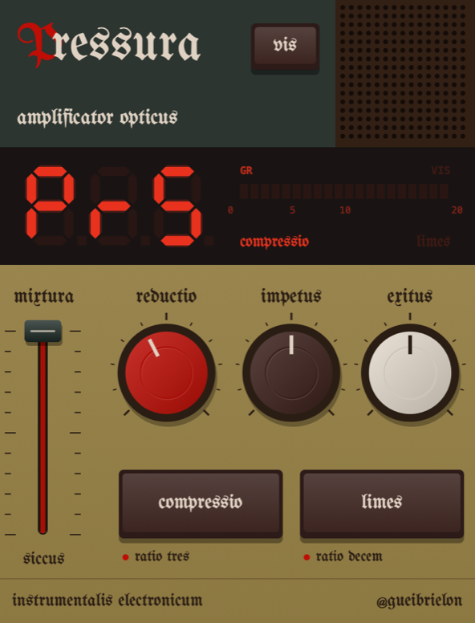
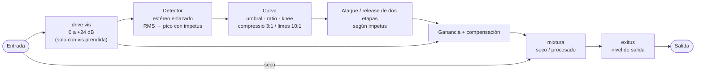

# Pressura

*amplificator opticus*: un compresor de estilo óptico con control de velocidad en una sola perilla y un modo drive.
VST3 · AU · Standalone · Windows 10/11 (64 bits) · macOS 11+ (Intel y Apple Silicon)

[Read in English](README.md)

<p align="center"></p>

Pressura parte del comportamiento suave y dependiente del programa de un nivelador óptico clásico (tipo LA-2A)
y te deja llevarlo a otro lado: subí **impetus** y se vuelve un compresor de bus rápido que bombea;
apretá **vis** y la perilla roja deja de bajar un umbral y empieza a *empujar* la señal contra él.

---

## Instalación

Bajá el último instalador de la página de **Releases**.

### Windows

1. Bajá **`Pressura-<versión>-Windows-Setup.exe`** y hacé doble click.
2. Windows va a decir *"Windows protegió su PC"*, porque Pressura no está firmado con un certificado pago.
   Tocá **Más información** → **Ejecutar de todas formas**. Pasa una sola vez.
3. Seguí el instalador. Pone el VST3 en `C:\Program Files\Common Files\VST3` y la app Standalone en
   `C:\Program Files\Pressura`, con acceso directo en el menú Inicio.
4. Volvé a escanear los plugins en tu DAW. Aparece como **Pressura** de **gueibrielon**.

**Desinstalar:** *Configuración → Aplicaciones → Pressura → Desinstalar*.

### macOS

1. Bajá **`Pressura-<versión>.pkg`** y hacé doble click.
2. macOS va a decir que no puede verificar al desarrollador, porque Pressura no está firmado con una cuenta
   paga de Apple. Pasa una sola vez:
   - **macOS 15 Sequoia o más nuevo:** tocá **OK**, abrí **Configuración del Sistema → Privacidad y seguridad**,
     bajá hasta *"Se bloqueó Pressura-….pkg"* y tocá **Abrir igualmente**.
   - **macOS 14 o anterior:** click derecho (o Control-click) en el .pkg, elegí **Abrir** y después **Abrir** otra vez.
3. Seguí el instalador. Pone los plugins acá (elegí **Personalizar** para dejar alguno afuera):
   - Audio Unit → `/Library/Audio/Plug-Ins/Components` (Logic, GarageBand, Ableton…)
   - VST3 → `/Library/Audio/Plug-Ins/VST3` (Ableton, Reaper, Bitwig, Cubase…)
   - App Standalone → `/Applications`
4. Volvé a escanear los plugins en tu DAW (Ableton: *Settings → Plug-Ins → Rescan*). Aparece como **Pressura** de **gueibrielon**.

No hace falta la Terminal: macOS no bloquea los plugins que instala el .pkg.

**Desinstalar:** borrá `Pressura.component`, `Pressura.vst3` y `Pressura.app` de esas carpetas.

---

## El panel

| Control | Qué hace | Rango | Por defecto |
|---|---|---|---|
| **reductio** (perilla roja) | Cuánto comprime. Baja el umbral y suma ganancia de compensación automática, así el nivel queda parecido mientras la dinámica se achica. | 0–100 (umbral −6 a −48 dB, compensación 0 a +9 dB) | 40 |
| **vis** (la misma perilla roja, con la tecla **vis** prendida) | Drive. Empuja la señal contra un umbral fijo de −12 dB. Lo fuerte queda más o menos igual, lo suave sube: más denso y más fuerte. | 0–100 (0 a +24 dB de drive) | 40 |
| **impetus** (perilla marrón) | Velocidad. Mueve ataque, release y detector juntos. Ver abajo. | 0–100 | 50 |
| **exitus** (perilla crema) | Nivel de salida, después de todo lo demás. | −18 a +18 dB | 0 dB |
| **mixtura** (fader) | Mezcla seco/procesado para compresión en paralelo. Arriba = todo comprimido, abajo (*siccus*, "seco") = sin tocar. | 0–100 % | 100 % |
| tecla **compressio** | Ratio de alrededor de 3:1 con knee suave de 8 dB. Musical, para nivelar. | | prendida |
| tecla **limes** | Ratio de alrededor de 10:1 con knee de 3 dB. Para agarrar picos o aplastar. | | apagada |
| tecla **vis** (panel de arriba) | Cambia la perilla roja entre **reductio** (limpio) y **vis** (drive). La serigrafía de la perilla cambia con ella. | | apagada |

**Doble click** en cualquier perilla o en el fader lo vuelve a su valor por defecto.

### impetus (velocidad)

| impetus | Ataque | Release | Carácter |
|---|---|---|---|
| 0 | ~30 ms | lento (~150 ms + la cola óptica) | Nivelación muy suave, casi transparente |
| **50** | **~10 ms** | **~60 ms + cola óptica de 1–3 s** | **El sonido óptico clásico** |
| 75 | ~1.7 ms | ~40 ms, cola más corta | Más apretado, agarra los transitorios |
| 100 | ~0.3 ms | ~30 ms, sin cola | Rápido, sensible a picos, bombea con el beat |

Hasta 50, Pressura se comporta como una celda óptica: responde al nivel promedio (RMS) y tiene un release de
dos etapas. La mitad de la reducción se suelta rápido; el resto tarda segundos en volver. Cuanto más tiempo
estuvo comprimiendo, más lenta la cola. Arriba de 50 esa "memoria" lenta se va apagando y el detector pasa de
nivel promedio a nivel de pico, así que el compresor sigue cada golpe y bombea.

### El visor

- En reposo muestra **PRS**.
- Mientras movés un control muestra el valor. **2 segundos** después de soltarlo, muestra el nombre:
  **RED** (reductio) o **DRV** (vis), **SPD** (impetus), **OUT** (exitus), **MIX** (mixtura).
- Las teclas muestran **CMP** / **LMT** y **VIS** / **CLN** al apretarlas.
- Medidor **GR**: cuánto se está reduciendo el nivel en este momento, de 0 a 20 dB. Los indicadores
  *compressio* / *limes* y **VIS** muestran los modos activos.

---

## Cómo funciona



- **Estéreo enlazado:** los dos canales reciben la misma reducción, así la imagen estéreo no se mueve.
- **Compensación:** en modo limpio, subir *reductio* suma hasta +9 dB, así escuchás sobre todo el cambio de
  dinámica y no de volumen. En modo *vis* la compensación es −drive ÷ ratio: lo que está muy por encima del
  umbral sale más o menos igual de fuerte que como entró, y todo lo más suave sube.
- La **señal seca** de la mezcla *mixtura* es siempre tu entrada original, nunca la empujada.
- Sin latencia, sin oversampling, sin lookahead.

---

## Puntos de partida

| Uso | Modo | Perilla roja | impetus | Ratio | mixtura |
|---|---|---|---|---|---|
| Nivelar voz o bajo | limpio | reductio 40–60 | 40–50 | compressio | 100 % |
| Pegar el bus master | limpio | reductio 15–30 | 30–50 | compressio | 100 % |
| Bus de batería que bombea | **vis** | vis 50–70 | 80–100 | compressio | 60–80 % |
| Aplastado en paralelo | limpio | reductio 80–100 | 70–90 | limes | 20–40 % |
| Fuerte y denso | **vis** | vis 60–90 | 50–70 | limes | 100 %, bajá exitus |

Con *vis* alto e *impetus* bajo, los transitorios pasan antes de que el compresor reaccione y pueden llegar a
0 dBFS. Bajá **exitus** o poné un limitador después de Pressura.

---

## Compilar desde el código

Necesitás las Command Line Tools (`xcode-select --install`) y CMake 3.22 o más nuevo
(de [cmake.org](https://cmake.org/download/), o `brew install cmake` en Apple Silicon). JUCE 8 se baja solo
la primera vez que configurás.

```bash
cmake -B build -G "Unix Makefiles" -DCMAKE_BUILD_TYPE=Release
cmake --build build -j8
```

Con Xcode instalado podés usar `cmake -B build -G Xcode && cmake --build build --config Release`.
El build es universal (arm64 + x86_64) y copia el AU y el VST3 directo a `~/Library/Audio/Plug-Ins`.
Validá el AU con `auval -v aufx Opt2 Guei`.

**Windows:** Visual Studio 2022 ("Desarrollo para el escritorio con C++") y CMake, después
`cmake -B build -G "Visual Studio 17 2022" -A x64` y `cmake --build build --config Release`.
El instalador de Windows se arma con [Inno Setup](https://jrsoftware.org/isinfo.php): `iscc /DAppVersion=<versión> tools\installer\pressura.iss`.

**Releases:** al subir un tag como `v0.1.0`, GitHub Actions arma los dos instaladores y los publica
(`.github/workflows/release.yml`).

Para armar el instalador de macOS: `./tools/make_installer.sh` → `build/installer/Pressura-<versión>.pkg`.
El script explica cómo firmarlo y notarizarlo si tenés una cuenta de Apple Developer.

### Archivos del proyecto
- `Source/OptoCompressor.h` — el DSP, sin dependencia de JUCE, se puede testear aparte
- `Source/PluginProcessor.*` — parámetros y procesamiento de audio
- `Source/PluginEditor.*` — la UI dibujada a mano (colores en `Palette`)
- `Tests/Snapshot.cpp` — renderiza la UI a PNG sin abrir un DAW:
  `cmake --build build --target OPTO2Snapshot`, después
  `build/OPTO2Snapshot_artefacts/Release/OPTO2Snapshot ui.png [vis] [limit]`

---

Fuente gótica: UnifrakturMaguntia, SIL Open Font License (`Resources/OFL.txt`), embebida en el plugin.
Hecho por @gueibrielon. Gratis para bajar y usar en tu música, incluso en lanzamientos comerciales.
El código fuente es de uso reservado; ver [LICENSE](LICENSE).
