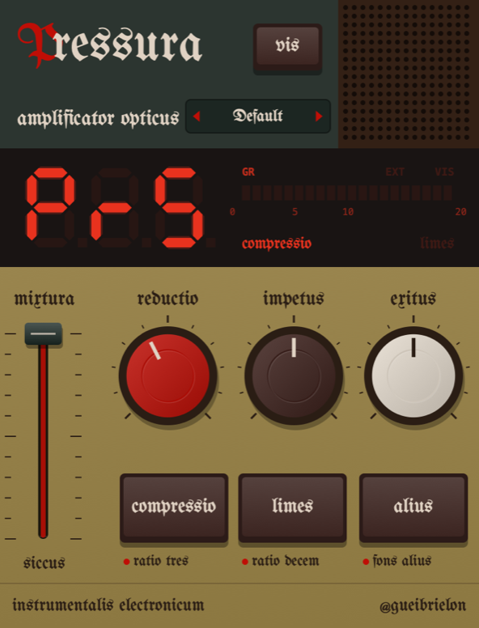
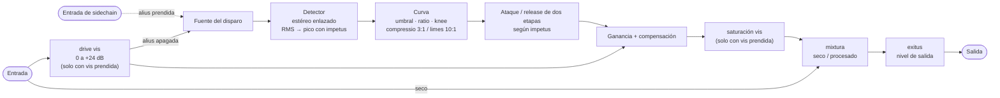

# Pressura

*amplificator opticus*: un compresor de estilo óptico con control de velocidad en una sola perilla y un modo drive.
VST3 · AU · Standalone · Windows 10/11 (64 bits) · macOS 11+ (Intel y Apple Silicon)

[Read in English](README.md)

<p align="center"></p>

Pressura parte del comportamiento suave y dependiente del programa de un nivelador óptico clásico (tipo LA-2A)
y te deja llevarlo a otro lado: subí **impetus** y se vuelve un compresor de bus rápido que bombea;
apretá **vis** y la perilla roja deja de bajar un umbral y empieza a *empujar* la señal contra él.

---

## Instalación

Bajá el último zip para tu computadora de la página de **Releases**. Trae el instalador y
**[Pressura Guide.pdf](docs/Pressura-Guide.pdf)**, una guía ilustrada de todos los controles.

### Windows

1. Descomprimí **`Pressura-<versión>-Windows.zip`** y hacé doble click en **`Pressura-<versión>-Windows-Setup.exe`**.
2. Windows va a decir *"Windows protegió su PC"*, porque Pressura no está firmado con un certificado pago.
   Tocá **Más información** → **Ejecutar de todas formas**. Pasa una sola vez.
3. Seguí el instalador. Pone el VST3 en `C:\Program Files\Common Files\VST3` y la app Standalone en
   `C:\Program Files\Pressura`, con accesos directos en el menú Inicio para la app y la guía.
4. Volvé a escanear los plugins en tu DAW. Aparece como **Pressura** de **gueibrielon**.

**Desinstalar:** *Configuración → Aplicaciones → Pressura → Desinstalar*.

### macOS

1. Descomprimí **`Pressura-<versión>-macOS.zip`** (Safari lo hace solo) y hacé doble click en **`Pressura-<versión>.pkg`**.
2. macOS va a decir que no puede verificar al desarrollador, porque Pressura no está firmado con una cuenta
   paga de Apple. Pasa una sola vez:
   - **macOS 15 Sequoia o más nuevo:** tocá **OK**, abrí **Configuración del Sistema → Privacidad y seguridad**,
     bajá hasta *"Se bloqueó Pressura-….pkg"* y tocá **Abrir igualmente**.
   - **macOS 14 o anterior:** click derecho (o Control-click) en el .pkg, elegí **Abrir** y después **Abrir** otra vez.
3. Seguí el instalador. Pone los plugins acá (elegí **Personalizar** para dejar alguno afuera):
   - Audio Unit → `/Library/Audio/Plug-Ins/Components` (Logic, GarageBand, Ableton…)
   - VST3 → `/Library/Audio/Plug-Ins/VST3` (Ableton, Reaper, Bitwig, Cubase…)
   - App Standalone → `/Applications`
4. Volvé a escanear los plugins en tu DAW (Ableton: *Settings → Plug-Ins → Rescan*). Aparece como **Pressura** de **gueibrielon**.

No hace falta la Terminal: macOS no bloquea los plugins que instala el .pkg.

**Desinstalar:** borrá `Pressura.component`, `Pressura.vst3` y `Pressura.app` de esas carpetas.

---

## El panel

| Control | Qué hace | Rango | Por defecto |
|---|---|---|---|
| **reductio** (perilla roja) | Cuánto comprime. Baja el umbral y suma ganancia de compensación automática, así el nivel queda parecido mientras la dinámica se achica. | 0–100 (umbral −6 a −48 dB, compensación 0 a +9 dB) | 40 |
| **vis** (la misma perilla roja, con la tecla **vis** prendida) | Drive + saturación. Empuja la señal contra un umbral fijo de −12 dB (lo fuerte queda más o menos igual, lo suave sube) y por un saturador que ensucia más cuanto más lo subís, como un sampler pasado de rosca. | 0–100 (0 a +24 dB de drive; saturación 0 a +10 dB) | 40 |
| **impetus** (perilla marrón) | Velocidad. Mueve ataque, release y detector juntos. Ver abajo. | 0–100 | 50 |
| **exitus** (perilla crema) | Nivel de salida, después de todo lo demás. | −18 a +18 dB | 0 dB |
| **mixtura** (fader) | Mezcla seco/procesado para compresión en paralelo. Arriba = todo comprimido, abajo (*siccus*, "seco") = sin tocar. | 0–100 % | 100 % |
| tecla **compressio** | Ratio de alrededor de 3:1 con knee suave de 8 dB. Musical, para nivelar. | | prendida |
| tecla **limes** | Ratio de alrededor de 10:1 con knee de 3 dB. Para agarrar picos o aplastar. | | apagada |
| **Barra de presets** (panel de arriba) | 9 presets de fábrica más Default: **‹ ›** para pasar, click en el nombre para la lista. | | Default |
| tecla **vis** (panel de arriba) | Cambia la perilla roja entre **reductio** (limpio) y **vis** (drive + saturación). La serigrafía de la perilla cambia con ella. | | apagada |
| tecla **alius** (*fons alius*, "otra fuente") | Apagada: Pressura escucha su propia pista. Prendida: escucha la pista que ruteás a su entrada de **sidechain** (ver abajo). | | apagada |

**Doble click** en cualquier perilla o en el fader lo vuelve a su valor por defecto.

### impetus (velocidad)

| impetus | Ataque | Release | Carácter |
|---|---|---|---|
| 0 | ~30 ms | lento (~150 ms + la cola óptica) | Nivelación muy suave, casi transparente |
| **50** | **~10 ms** | **~60 ms + cola óptica de 1–3 s** | **El sonido óptico clásico** |
| 75 | ~1.7 ms | ~40 ms, cola más corta | Más apretado, agarra los transitorios |
| 100 | ~0.3 ms | ~30 ms, sin cola | Rápido, sensible a picos, bombea con el beat |

Hasta 50, Pressura se comporta como una celda óptica: responde al nivel promedio (RMS) y tiene un release de
dos etapas. La mitad de la reducción se suelta rápido; el resto tarda segundos en volver. Cuanto más tiempo
estuvo comprimiendo, más lenta la cola. Arriba de 50 esa "memoria" lenta se va apagando y el detector pasa de
nivel promedio a nivel de pico, así que el compresor sigue cada golpe y bombea.

### Sidechain

Con **alius** prendida, otra pista decide cuándo comprime Pressura: el clásico "el bajo se agacha con el bombo".
Lo que oís sigue siendo tu pista; solo baja (sin compensación de ganancia), nunca sube.

**Cómo rutear la pista que dispara** (la elegís en tu DAW, no en el plugin), y después prendé **alius**:
- **Ableton Live:** abrí la sección Sidechain del dispositivo Pressura (el triangulito en su barra de título) y elegí la pista en *Audio From*.
- **Logic Pro:** elegí la pista en el menú **Side Chain** arriba de la ventana del plugin.
- **FL Studio:** en el insert de la pista que dispara, click derecho en la flecha hacia el insert de Pressura → *Sidechain to this track*; después en el wrapper de Pressura (pestaña *Processing*) elegí la entrada de sidechain.
- **Reaper:** agregá un send desde la pista que dispara a la pista de Pressura en los canales 3/4.
- **Cubase:** tocá el botón de sidechain arriba de la ventana del plugin y agregá la pista como fuente de side-chain.

Si **alius** está prendida pero no ruteaste nada, Pressura no tiene qué escuchar y no comprime.

### El visor

- En reposo muestra **PRS**.
- Mientras movés un control muestra el valor. **2 segundos** después de soltarlo, muestra el nombre:
  **RED** (reductio) o **DRV** (vis), **SPD** (impetus), **OUT** (exitus), **MIX** (mixtura).
- Las teclas muestran **CMP** / **LMT**, **VIS** / **CLN** y **EXT** / **INT** al apretarlas.
- **EXT** arriba del medidor se prende mientras la entrada de sidechain es la que dispara.
- Medidor **GR**: cuánto se está reduciendo el nivel en este momento, de 0 a 20 dB. Los indicadores
  *compressio* / *limes* y **VIS** muestran los modos activos.

---

## Cómo funciona



- **Estéreo enlazado:** los dos canales reciben la misma reducción, así la imagen estéreo no se mueve.
- **Compensación:** en modo limpio, subir *reductio* suma hasta +9 dB, así escuchás sobre todo el cambio de
  dinámica y no de volumen. En modo *vis* la compensación es −drive ÷ ratio: lo que está muy por encima del
  umbral sale más o menos igual de fuerte que como entró, y todo lo más suave sube.
- La **señal seca** de la mezcla *mixtura* es siempre tu entrada original, nunca la empujada.
- **Saturación vis:** tanh apenas asimétrico (armónicos pares), compensado para que ensucie sin subir el volumen.
  Con un seno a −12 dBFS: ~2 % de THD en vis 0, 4,5 % en 50, 8 % en 100.
- La **entrada de sidechain** pasa por el mismo drive (en modo *vis*) que tu propia señal; con **alius** no hay compensación.
- Sin latencia, sin oversampling, sin lookahead.

---

## Presets

Usá la barra debajo del título: **‹ ›** para pasar de uno a otro, click en el nombre para ver la lista (el visor
muestra **P01**–**P09** durante 2 s). El menú de presets de tu DAW también los muestra. Son puntos de partida: ajustá **reductio** / **vis** a oído.

| Preset | Para |
|---|---|
| **Default** | Valores de fábrica: el punto de partida. |
| **Vocal Leveler** | Voces, locución: nivelado óptico suave, unos 3 dB. |
| **Bass Leveler** | Bajo directo o de sinte: empareja las notas. |
| **Drum Bus Glue** | Bus de batería, calibrado contra un FET estilo 1176 en 4:1 con release rápido: unos 5 dB en los golpes, el bombo y los graves quedan iguales, percusiones y notas fantasma suben unos 3 dB. |
| **Mix Bus Glue** | Bus de mezcla: 1–2 dB, calibrado contra un compresor de bus estilo SSL en 2:1; mismo volumen a la entrada y a la salida. |
| **Parallel Smash** | Batería o lo que sea: aplastado unos 11 dB a 10:1 y mezclado al 30 %, como un 1176 con todos los botones en un bus paralelo. |
| **Peak Limiter** | Lo que sea: 10:1 y rápido, solo agarra los picos. |
| **Drum Bus Pump** | Bus de batería: drive y saturación vis, bombea con el beat como un 1176 con todos los botones; mismo volumen a la entrada y a la salida. |
| **Crunch** | Batería, loops, sintes: saturación vis, sucio y denso. |
| **Bass Sidechain** | Bajo que se agacha con el bombo (~8 dB por golpe). Ruteá la batería al sidechain de Pressura. |

Con *vis* alto e *impetus* bajo, los transitorios pasan antes de que el compresor reaccione y pueden llegar a
0 dBFS. Bajá **exitus** o poné un limitador después de Pressura.

---

## Compilar desde el código

Necesitás las Command Line Tools (`xcode-select --install`) y CMake 3.22 o más nuevo
(de [cmake.org](https://cmake.org/download/), o `brew install cmake` en Apple Silicon). JUCE 8 se baja solo
la primera vez que configurás.

```bash
cmake -B build -G "Unix Makefiles" -DCMAKE_BUILD_TYPE=Release
cmake --build build -j8
```

Con Xcode instalado podés usar `cmake -B build -G Xcode && cmake --build build --config Release`.
El build es universal (arm64 + x86_64) y copia el AU y el VST3 directo a `~/Library/Audio/Plug-Ins`.
Validá el AU con `auval -v aufx Opt2 Guei`.

**Windows:** Visual Studio 2022 o más nuevo ("Desarrollo para el escritorio con C++") y CMake, después
`cmake -B build -A x64` y `cmake --build build --config Release`.
El instalador de Windows se arma con [Inno Setup](https://jrsoftware.org/isinfo.php): `iscc /DAppVersion=<versión> tools\installer\pressura.iss`.

**Releases:** al subir un tag como `v0.1.0`, GitHub Actions arma los dos instaladores y los publica
(`.github/workflows/release.yml`).

Para armar el instalador de macOS: `./tools/make_installer.sh` → `build/installer/Pressura-<versión>.pkg`.
El script explica cómo firmarlo y notarizarlo si tenés una cuenta de Apple Developer.

### Archivos del proyecto
- `Source/OptoCompressor.h` — el DSP, sin dependencia de JUCE, se puede testear aparte
- `Source/PluginProcessor.*` — parámetros y procesamiento de audio
- `Source/PluginEditor.*` — la UI dibujada a mano (colores en `Palette`)
- `Source/Saturator.h` — la saturación de vis, sin dependencia de JUCE
- `Source/Presets.h` — los presets de fábrica
- `Tests/SidechainTest.cpp` — corre el plugin offline y verifica el ruteo del sidechain, la saturación vis y los presets:
  `cmake --build build --target OPTO2SidechainTest`, después `build/OPTO2SidechainTest_artefacts/Release/OPTO2SidechainTest`
- `tools/guide/make_guide.py` — arma `docs/Pressura-Guide.pdf` (necesita Google Chrome)
- `Tests/Snapshot.cpp` — renderiza la UI a PNG sin abrir un DAW:
  `cmake --build build --target OPTO2Snapshot`, después
  `build/OPTO2Snapshot_artefacts/Release/OPTO2Snapshot ui.png [vis] [limit] [ext]`

---

Fuente gótica: UnifrakturMaguntia, SIL Open Font License (`Resources/OFL.txt`), embebida en el plugin.
Hecho por @gueibrielon. Gratis para bajar y usar en tu música, incluso en lanzamientos comerciales.
El código fuente es de uso reservado; ver [LICENSE](LICENSE).
