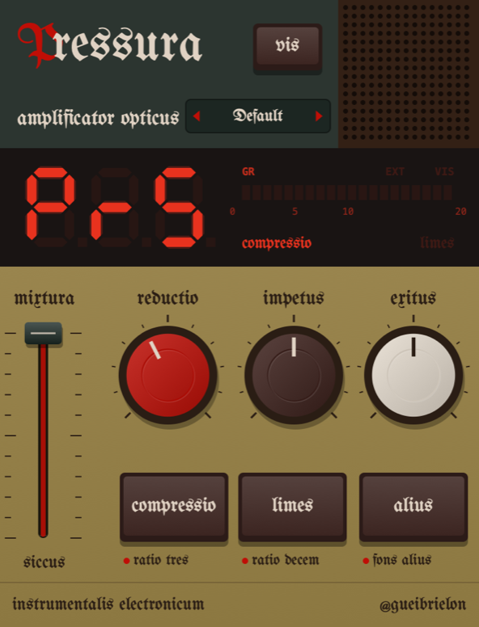
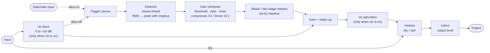

# Pressura

*amplificator opticus* — an optical-style compressor with a one-knob speed control and a drive mode.
VST3 · AU · Standalone · Windows 10/11 (64-bit) · macOS 11+ (Intel and Apple Silicon)

[Leer en español](README.es.md)

<p align="center"></p>

Pressura starts from the smooth, program-dependent behaviour of a classic optical leveller (think LA-2A)
and lets you push it somewhere else: turn **impetus** up and it becomes a fast, pumping bus compressor;
press **vis** and the red knob stops lowering a threshold and starts *driving* the signal into one.

---

## Installing

Download the latest zip for your computer from the **Releases** page. It contains the installer and
**[Pressura Guide.pdf](docs/Pressura-Guide.pdf)**, an illustrated guide to every control (English and Spanish).

### Windows

1. Unzip **`Pressura-<version>-Windows.zip`** and double-click **`Pressura-<version>-Windows-Setup.exe`**.
2. Windows will say *"Windows protected your PC"*, because Pressura isn't signed with a paid certificate.
   Click **More info** → **Run anyway**. This only happens once.
3. Follow the installer. It puts the VST3 in `C:\Program Files\Common Files\VST3` and the Standalone app in
   `C:\Program Files\Pressura`, with Start menu shortcuts for the app and the guide.
4. Rescan plugins in your DAW. It appears as **Pressura** by **gueibrielon**.

**Uninstall:** *Settings → Apps → Pressura → Uninstall*.

### macOS

1. Unzip **`Pressura-<version>-macOS.zip`** (Safari does it for you) and double-click **`Pressura-<version>.pkg`**.
2. macOS will say it can't verify the developer, because Pressura isn't signed with a paid Apple account.
   This only happens once:
   - **macOS 15 Sequoia or newer:** click **Done**, open **System Settings → Privacy & Security**, scroll down
     to *"Pressura-….pkg was blocked"* and click **Open Anyway**.
   - **macOS 14 or older:** right-click (or Control-click) the .pkg, choose **Open**, then **Open** again.
3. Follow the installer. It puts the plugins here (choose **Customize** to leave any out):
   - Audio Unit → `/Library/Audio/Plug-Ins/Components` (Logic, GarageBand, Ableton…)
   - VST3 → `/Library/Audio/Plug-Ins/VST3` (Ableton, Reaper, Bitwig, Cubase…)
   - Standalone app → `/Applications`
4. Rescan plugins in your DAW (Ableton: *Settings → Plug-Ins → Rescan*). It appears as **Pressura** by **gueibrielon**.

No Terminal needed: plugins installed by the .pkg are not blocked by macOS.

**Uninstall:** delete `Pressura.component`, `Pressura.vst3` and `Pressura.app` from the folders above.

---

## The panel

| Control | What it does | Range | Default |
|---|---|---|---|
| **reductio** (red knob) | How much it compresses. Lowers the threshold and adds automatic make-up gain, so the level stays roughly the same while the dynamics get smaller. | 0–100 (threshold −6 to −48 dB, make-up 0 to +9 dB) | 40 |
| **vis** (same red knob, when the **vis** key is on) | Drive + saturation. Pushes the signal into a fixed −12 dB threshold (loud parts stay about where they were, quiet parts come up) and through a saturator that gets dirtier as you turn it up, like a sampler pushed into the red. | 0–100 (0 to +24 dB of drive; saturation 0 to +10 dB) | 40 |
| **impetus** (brown knob) | Speed. Moves attack, release and the detector together. See below. | 0–100 | 50 |
| **exitus** (cream knob) | Output level, after everything else. | −18 to +18 dB | 0 dB |
| **mixtura** (fader) | Dry/wet mix for parallel compression. Top = all compressed, bottom (*siccus*, "dry") = untouched. | 0–100 % | 100 % |
| **compressio** key | Ratio about 3:1 with a soft 8 dB knee. Musical, for levelling. | | on |
| **limes** key | Ratio about 10:1 with a 3 dB knee. For catching peaks or squashing. | | off |
| **Preset bar** (top panel) | 9 factory presets plus Default: **‹ ›** step, click the name for the list. | | Default |
| **vis** key (top panel) | Switches the red knob between **reductio** (clean) and **vis** (drive + saturation). The knob's label changes with it. | | off |
| **alius** key (*fons alius*, "other source") | Off: Pressura listens to its own track. On: it listens to the track routed into its **sidechain** input (see below). | | off |

**Double-click** any knob or the fader to return it to its default.

### impetus (speed)

| impetus | Attack | Release | Character |
|---|---|---|---|
| 0 | ~30 ms | slow (~150 ms + the optical tail) | Very smooth, almost transparent levelling |
| **50** | **~10 ms** | **~60 ms + 1–3 s optical tail** | **The classic optical sound** |
| 75 | ~1.7 ms | ~40 ms, shorter tail | Tighter, transients get caught |
| 100 | ~0.3 ms | ~30 ms, no tail | Fast, peak-sensing, pumps with the beat |

Up to 50, Pressura behaves like an optical cell: it responds to the average level (RMS) and has a two-stage
release. Half the gain reduction lets go quickly; the rest takes seconds to recover. The longer it has been
compressing, the slower the tail. Above 50 that slow "memory" fades out and the detector switches from
average to peak level, so the compressor follows each hit and pumps.

### Sidechain

With **alius** on, another track decides when Pressura compresses: the classic "bass ducks under the kick".
The sound you hear is still your own track; it only goes down (no make-up gain), never up.

**Routing the trigger track** (you choose it in your DAW, not in the plugin), then press **alius**:
- **Ableton Live:** open the Sidechain section on the Pressura device (the small triangle in its title bar) and choose the track under *Audio From*.
- **Logic Pro:** pick the track in the **Side Chain** menu at the top of the plugin window.
- **FL Studio:** on the trigger track's mixer insert, right-click the arrow to Pressura's insert → *Sidechain to this track*; then in Pressura's wrapper (*Processing* tab) set the sidechain input.
- **Reaper:** add a send from the trigger track to Pressura's track on channels 3/4.
- **Cubase:** click the sidechain button at the top of the plugin window and add the trigger track as a side-chain source.

If **alius** is on but nothing is routed, Pressura has nothing to listen to and won't compress.

### The display

- At rest it shows **PRS**.
- While you move a control it shows the value. **2 seconds** after you let go, it shows the control's name:
  **RED** (reductio) or **DRV** (vis), **SPD** (impetus), **OUT** (exitus), **MIX** (mixtura).
- The keys show **CMP** / **LMT**, **VIS** / **CLN** and **EXT** / **INT** when pressed.
- **EXT** above the meter lights up while the sidechain input is the trigger.
- **GR** meter: how much the level is being reduced right now, 0 to 20 dB. The *compressio* / *limes* and
  **VIS** indicators below and above it show the current modes.

---

## How it works



- **Stereo-linked:** both channels get the same gain reduction, so the stereo image doesn't move.
- **Make-up gain:** in clean mode, raising *reductio* adds up to +9 dB, so you mostly hear the dynamics
  change rather than the volume. In *vis* mode the make-up is −drive ÷ ratio: whatever is far above the
  threshold comes out about as loud as it went in, and everything quieter gets louder.
- **Dry signal** in the *mixtura* blend is always your original input, never driven.
- **vis saturation:** a slightly asymmetric tanh (even harmonics), level-matched so it adds grit, not volume.
  On a −12 dBFS sine: about 2 % THD at vis 0, 4.5 % at 50, 8 % at 100.
- **Sidechain input** goes through the same drive (in *vis* mode) as your own signal would; with **alius** there is no make-up.
- No latency, no oversampling, no lookahead.

---

## Presets

Use the bar under the title: **‹ ›** step through them, click the name for the list (the display shows
**P01**–**P09** for 2 s). Your DAW's preset menu lists them too. They're starting points: adjust **reductio** / **vis** to taste.

| Preset | For |
|---|---|
| **Default** | Factory settings: the starting point. |
| **Vocal Leveler** | Vocals, voice-over: smooth optical levelling, about 3 dB. |
| **Bass Leveler** | DI or synth bass: evens out the notes. |
| **Drum Bus Glue** | Drum bus, voiced after a 1176-style FET at 4:1 with fast release: about 5 dB on the hits, the kick and low end stay put, quieter percussion and ghost notes come up about 3 dB. |
| **Mix Bus Glue** | Mix bus: about 1–2 dB, voiced after an SSL-style bus compressor at 2:1; same level in and out. |
| **Parallel Smash** | Drums or anything: crushed about 11 dB at 10:1 and blended in at 30 %, like a 1176 with all buttons in on a parallel bus. |
| **Peak Limiter** | Anything: 10:1 and fast, only catches the peaks. |
| **Drum Bus Pump** | Drum bus: vis drive and saturation, pumps with the beat like a 1176 with all buttons in; same level in and out. |
| **Crunch** | Drums, loops, synths: vis saturation, dirty and dense. |
| **Bass Sidechain** | Bass ducked by the kick (~8 dB per hit). Route the drums to Pressura's sidechain. |

With *vis* high and *impetus* low, transients get through before the compressor reacts and can hit 0 dBFS.
Pull **exitus** down or put a limiter after Pressura.

---

## Building from source

You need the Command Line Tools (`xcode-select --install`) and CMake 3.22 or newer
(from [cmake.org](https://cmake.org/download/) or `brew install cmake` on Apple Silicon). JUCE 8 is downloaded
automatically the first time you configure.

```bash
cmake -B build -G "Unix Makefiles" -DCMAKE_BUILD_TYPE=Release
cmake --build build -j8
```

With Xcode installed you can use `cmake -B build -G Xcode && cmake --build build --config Release` instead.
The build is universal (arm64 + x86_64) and copies the AU and VST3 straight into `~/Library/Audio/Plug-Ins`.
Validate the AU with `auval -v aufx Opt2 Guei`.

**Windows:** Visual Studio 2022 or newer ("Desktop development with C++") and CMake, then
`cmake -B build -A x64` and `cmake --build build --config Release`.
The Windows installer is built with [Inno Setup](https://jrsoftware.org/isinfo.php): `iscc /DAppVersion=<version> tools\installer\pressura.iss`.

**Releases:** pushing a tag like `v0.1.0` makes GitHub Actions build both installers and publish them
(`.github/workflows/release.yml`).

To build the macOS installer: `./tools/make_installer.sh` → `build/installer/Pressura-<version>.pkg`.
The script explains how to sign and notarize it if you have an Apple Developer account.

### Project files
- `Source/OptoCompressor.h` — the DSP, no JUCE dependency, can be tested on its own
- `Source/PluginProcessor.*` — parameters and audio processing
- `Source/PluginEditor.*` — the hand-drawn UI (colours in `Palette`)
- `Source/Saturator.h` — the vis saturation, no JUCE dependency
- `Source/Presets.h` — the factory presets
- `Tests/SidechainTest.cpp` — runs the plugin offline and checks sidechain routing, vis saturation and presets:
  `cmake --build build --target OPTO2SidechainTest`, then `build/OPTO2SidechainTest_artefacts/Release/OPTO2SidechainTest`
- `tools/guide/make_guide.py` — builds `docs/Pressura-Guide.pdf` (needs Google Chrome)
- `Tests/Snapshot.cpp` — renders the UI to a PNG without a DAW:
  `cmake --build build --target OPTO2Snapshot`, then
  `build/OPTO2Snapshot_artefacts/Release/OPTO2Snapshot ui.png [vis] [limit] [ext]`

---

Blackletter font: UnifrakturMaguntia, SIL Open Font License (`Resources/OFL.txt`), embedded in the plugin.
Made by @gueibrielon. Free to download and use in your music, including commercial releases.
The source code is all rights reserved; see [LICENSE](LICENSE).
