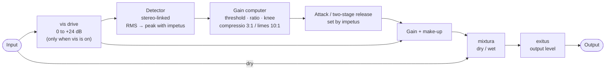

# Pressura

*amplificator opticus* — an optical-style compressor with a one-knob speed control and a drive mode.
AU · VST3 · Standalone · macOS 11+ (Intel and Apple Silicon)

[Leer en español](README.es.md)

<p align="center"></p>

Pressura starts from the smooth, program-dependent behaviour of a classic optical leveller (think LA-2A)
and lets you push it somewhere else: turn **impetus** up and it becomes a fast, pumping bus compressor;
press **vis** and the red knob stops lowering a threshold and starts *driving* the signal into one.

---

## Installing

1. Copy the plugins into these folders (create them if they don't exist):
   - `Pressura.component` → `~/Library/Audio/Plug-Ins/Components`  (Audio Unit: Logic, GarageBand, Ableton…)
   - `Pressura.vst3` → `~/Library/Audio/Plug-Ins/VST3`  (Ableton, Reaper, Bitwig, Cubase…)
   - `Pressura.app` (Standalone) can go anywhere, e.g. `/Applications`.
2. macOS blocks plugins downloaded from the internet that aren't notarized. If your DAW doesn't show
   Pressura, or macOS says it "can't be opened", run this in Terminal:
   ```bash
   xattr -dr com.apple.quarantine ~/Library/Audio/Plug-Ins/Components/Pressura.component ~/Library/Audio/Plug-Ins/VST3/Pressura.vst3
   ```
3. Rescan plugins in your DAW (Ableton: *Settings → Plug-Ins → Rescan*). It appears as **Pressura** by **gueibrielon**.

---

## The panel

| Control | What it does | Range | Default |
|---|---|---|---|
| **reductio** (red knob) | How much it compresses. Lowers the threshold and adds automatic make-up gain, so the level stays roughly the same while the dynamics get smaller. | 0–100 (threshold −6 to −48 dB, make-up 0 to +9 dB) | 40 |
| **vis** (same red knob, when the **vis** key is on) | Drive. Pushes the signal into a fixed −12 dB threshold. Loud parts stay about where they were, quiet parts come up: denser and louder. | 0–100 (0 to +24 dB of drive) | 40 |
| **impetus** (brown knob) | Speed. Moves attack, release and the detector together. See below. | 0–100 | 50 |
| **exitus** (cream knob) | Output level, after everything else. | −18 to +18 dB | 0 dB |
| **mixtura** (fader) | Dry/wet mix for parallel compression. Top = all compressed, bottom (*siccus*, "dry") = untouched. | 0–100 % | 100 % |
| **compressio** key | Ratio about 3:1 with a soft 8 dB knee. Musical, for levelling. | | on |
| **limes** key | Ratio about 10:1 with a 3 dB knee. For catching peaks or squashing. | | off |
| **vis** key (top panel) | Switches the red knob between **reductio** (clean) and **vis** (drive). The knob's label changes with it. | | off |

**Double-click** any knob or the fader to return it to its default.

### impetus (speed)

| impetus | Attack | Release | Character |
|---|---|---|---|
| 0 | ~30 ms | slow (~150 ms + the optical tail) | Very smooth, almost transparent levelling |
| **50** | **~10 ms** | **~60 ms + 1–3 s optical tail** | **The classic optical sound** |
| 75 | ~1.7 ms | ~40 ms, shorter tail | Tighter, transients get caught |
| 100 | ~0.3 ms | ~30 ms, no tail | Fast, peak-sensing, pumps with the beat |

Up to 50, Pressura behaves like an optical cell: it responds to the average level (RMS) and has a two-stage
release. Half the gain reduction lets go quickly; the rest takes seconds to recover. The longer it has been
compressing, the slower the tail. Above 50 that slow "memory" fades out and the detector switches from
average to peak level, so the compressor follows each hit and pumps.

### The display

- At rest it shows **PRS**.
- While you move a control it shows the value. **2 seconds** after you let go, it shows the control's name:
  **RED** (reductio) or **DRV** (vis), **SPD** (impetus), **OUT** (exitus), **MIX** (mixtura).
- The keys show **CMP** / **LMT** and **VIS** / **CLN** when pressed.
- **GR** meter: how much the level is being reduced right now, 0 to 20 dB. The *compressio* / *limes* and
  **VIS** indicators below and above it show the current modes.

---

## How it works



- **Stereo-linked:** both channels get the same gain reduction, so the stereo image doesn't move.
- **Make-up gain:** in clean mode, raising *reductio* adds up to +9 dB, so you mostly hear the dynamics
  change rather than the volume. In *vis* mode the make-up is −drive ÷ ratio: whatever is far above the
  threshold comes out about as loud as it went in, and everything quieter gets louder.
- **Dry signal** in the *mixtura* blend is always your original input, never driven.
- No latency, no oversampling, no lookahead.

---

## Starting points

| Use | Mode | Red knob | impetus | Ratio | mixtura |
|---|---|---|---|---|---|
| Vocal or bass levelling | clean | reductio 40–60 | 40–50 | compressio | 100 % |
| Mix bus glue | clean | reductio 15–30 | 30–50 | compressio | 100 % |
| Drum bus that pumps | **vis** | vis 50–70 | 80–100 | compressio | 60–80 % |
| Parallel smash | clean | reductio 80–100 | 70–90 | limes | 20–40 % |
| Loud and dense | **vis** | vis 60–90 | 50–70 | limes | 100 %, lower exitus |

With *vis* high and *impetus* low, transients get through before the compressor reacts and can hit 0 dBFS.
Pull **exitus** down or put a limiter after Pressura.

---

## Building from source

You need the Command Line Tools (`xcode-select --install`) and CMake 3.22 or newer
(from [cmake.org](https://cmake.org/download/) or `brew install cmake` on Apple Silicon). JUCE 8 is downloaded
automatically the first time you configure.

```bash
cmake -B build -G "Unix Makefiles" -DCMAKE_BUILD_TYPE=Release
cmake --build build -j8
```

With Xcode installed you can use `cmake -B build -G Xcode && cmake --build build --config Release` instead.
The build is universal (arm64 + x86_64) and copies the AU and VST3 straight into `~/Library/Audio/Plug-Ins`.
Validate the AU with `auval -v aufx Opt2 Guei`.

### Project files
- `Source/OptoCompressor.h` — the DSP, no JUCE dependency, can be tested on its own
- `Source/PluginProcessor.*` — parameters and audio processing
- `Source/PluginEditor.*` — the hand-drawn UI (colours in `Palette`)
- `Tests/Snapshot.cpp` — renders the UI to a PNG without a DAW:
  `cmake --build build --target OPTO2Snapshot`, then
  `build/OPTO2Snapshot_artefacts/Release/OPTO2Snapshot ui.png [vis] [limit]`

---

Blackletter font: UnifrakturMaguntia, SIL Open Font License (`Resources/OFL.txt`), embedded in the plugin.
Made by @gueibrielon.
